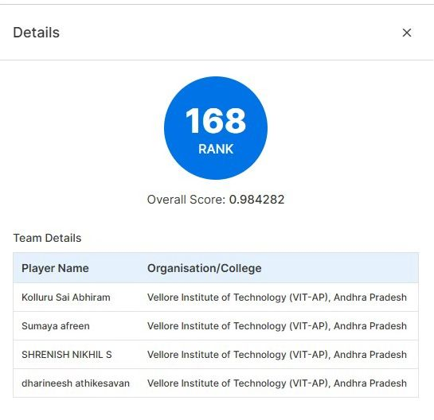

# Business Entity Resolution — Amazon ML Challenge 2026

Links every Source-1 business record to its matching Source-2 / Source-3 records across ~22M noisy
records (typos, OCR errors, native Indic scripts, reordered names, abbreviated addresses).

**CPU only. No external data, APIs or pretrained models.** Optimized directly for the official
entity-level macro F0.5.

## Final result

**Rank 168 · leaderboard score 0.984282**



**Team:** Kolluru Sai Abhiram, Sumaya Afreen, Shrenish Nikhil S, Dharineesh Athikesavan
(Vellore Institute of Technology, VIT-AP)

## Validation

| Metric | Value |
|---|---|
| Validation macro F0.5 (44,736 held-out S1 entities, full pipeline) | **0.9739** |
| Oracle F0.5 (perfect classifier on our candidates) | 0.9895 |
| Blocking recall | 0.971 at ~66 candidates per S1 |

## Pipeline

```
raw TSV
  └─► normalize      multi-representation: anyascii transliteration, OCR repair, legal-form class,
                     name signature, consonant skeleton, canonical address tokens
  └─► block          IDF-weighted inverted index over 6 typed keys, queried both ways
                     (S1 → pool and pool → S1), name / address / combined top-k channels
  └─► features       ~60 pair features: rapidfuzz similarities, token & number overlap,
                     house-number edit patterns, legal-form conflicts, name commonness, reverse ranks
  └─► LightGBM ×2    stage 1 scores pairs; stage 2 adds per-S1 context (rank, gap to best)
  └─► decide         exclusive best-S1 assignment + threshold tuned on macro F0.5
  └─► matching_results.tsv + candidate_pairs.tsv ─► official validator
```

### Key ideas

1. **Bidirectional blocking.** Every pool record also queries an index over S1 keys. This recovered
   37% of forward-blocking misses, and its rank became the strongest model feature.
2. **Typed blocking keys:** name signature token, name token pair, concatenated name, address word,
   house number × address word, and name skeleton × address word. Keys held by more than 1,000 records
   are dropped.
3. **Features aimed at the dataset's hard negatives:** legal-form conflicts (`Pvt Ltd` vs `LLP`),
   name commonness (term frequency), truncated or prefixed house numbers (`710` ⊂ `3710`).
4. **Every decision is measured on the exact per-entity metric**, singletons included.

### Progress

| Step | Val macro F0.5 |
|---|---|
| Baseline (4 key types, 49 features) | 0.9406 |
| + legal-form / house-prefix / ordinal / state normalization | 0.9584 |
| + OCR fixes, `& Co` class, stage-2 model | 0.9598 |
| + 3× training data | 0.9615 |
| + reverse blocking & reverse-rank features | 0.9691 |
| + house-number diff features, reverse-margin features (final) | **0.9739** |

## Repository layout

```
code/business_entity_resolution/
  src/            pipeline modules (entry points: train.py, inference.py)
  configs/        JSON experiment configs — final.json is the submitted model
  aws/            optional SageMaker launcher (same entry points)
  requirements.txt
lab/              research harness and experiment scripts
handover/         architecture, reproducibility notes, experiment registry, bibliography
Documentation_template.md   challenge write-up (methodology, blocking, model, error analysis)
EXPERIMENTS.md    full log of every experiment with measured results
ROADMAP.md        status and next steps
```

| Module | Role |
|---|---|
| `config.py` | dataclass config + JSON overlay; CLI / SageMaker env path resolution |
| `data_io.py` | TSV readers (UTF-8, quoting off), parquet cache |
| `normalize.py` | deterministic normalization and record representations |
| `dataset.py` | stable train/val split by S1 entity |
| `blocking.py` | typed keys, capped IDF index, 3-channel top-k, reverse pass, recall report |
| `features.py` | pair and per-S1 context features |
| `train.py` | blocking → features → 2-stage LightGBM → threshold → model bundle |
| `inference.py` | bundle → blocking → features → scores → decision → TSVs → validator |
| `decision.py` | exclusivity, threshold sweep |
| `metrics.py` | official macro F0.5 (per S1, singletons included) |
| `submission.py` | TSV writers + validator call |
| `evaluate.py`, `decide_eval.py` | error analysis |

## Setup

Python 3.10+ (developed on 3.13).

```bash
pip install -r code/business_entity_resolution/requirements.txt
# polars, numpy, rapidfuzz, lightgbm, anyascii, psutil
```

The dataset is not included. Place the official challenge files at:

```
student_resource/dataset/train/train_source{1,2,3}.tsv, train_ground_truth.tsv
student_resource/dataset/test/test_source{1,2,3}.tsv
student_resource/utils/validate_submission.py
```

**Hardware:** 16 CPU cores, 64 GB RAM. Final training peaks at ~44 GB. On machines with less than
~48 GB, lower `train_frac` / `es_frac` in the config.

## Usage

Run from `code/business_entity_resolution/src`:

```bash
# blocking recall report on held-out training S1s
python blocking.py --config ../configs/final.json

# train (~50 min with warm caches) → artifacts/models/final/
python train.py --config ../configs/final.json

# test inference (~2.5 h) → matching_results.tsv, candidate_pairs.tsv, then the official validator
python inference.py --model-dir ../../../artifacts/models/final --out-dir ../../../output_final

# re-threshold from saved scores without re-scoring
python inference.py --model-dir ../../../artifacts/models/final \
    --scores ../../../output_final/pair_scores_test.parquet --threshold 0.85 --out-dir ../../../output_t085
```

Always pass `--out-dir`. Without it, inference writes to `output/` and overwrites earlier results.
Paths can be overridden with `--data-dir` / `--work-dir`. On SageMaker they come from `SM_CHANNEL_DATA`,
`SM_MODEL_DIR` and `SM_OUTPUT_DATA_DIR`.

All randomness is seeded (split hash, LightGBM `seed` + `deterministic`). Every run writes its config
and metrics to `artifacts/runs/` and appends a row to `artifacts/experiments.tsv`.

## Documentation

- [Documentation_template.md](Documentation_template.md): full solution write-up
- [handover/ER_ARCHITECTURE.md](handover/ER_ARCHITECTURE.md): detailed architecture
- [handover/ER_REPRODUCIBILITY.md](handover/ER_REPRODUCIBILITY.md): commands, timings, memory
- [EXPERIMENTS.md](EXPERIMENTS.md): every experiment and its measured result
