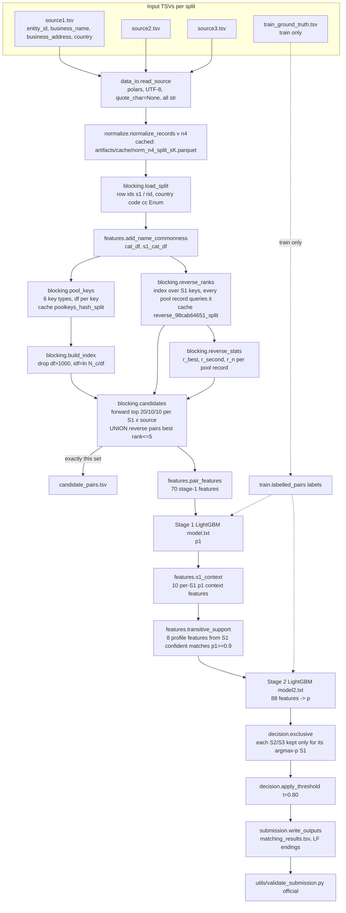
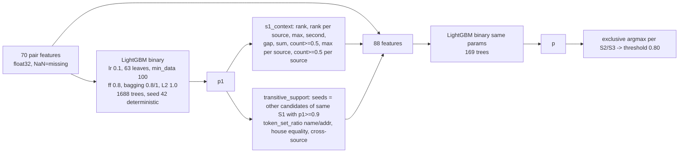
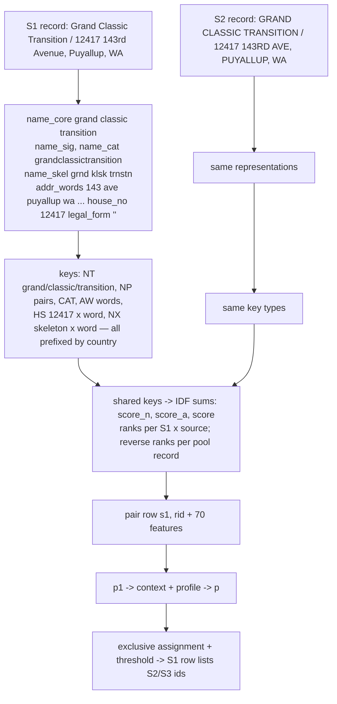

# ER_ARCHITECTURE — Business Entity Resolution (Amazon ML Challenge 2026)

Confidence labels used: **Verified** (read from code/artifacts during this audit), **Documented** (recorded in project
notes or the working conversation, not re-run during the audit), **Inferred**, **Proposed**, **Unknown**.
Experiment IDs (B#, M#, R#, V#, …) refer to `ER_EXPERIMENT_REGISTRY.csv` / `ER_MASTER_HANDOVER.md`.

Code root: `code/business_entity_resolution/src/` (13 modules, 1,590 lines — Verified). There is **no git repository**;
the only code snapshot is `artifacts/baseline_best/code_snapshot.zip` (state of 26-09 06:20, i.e. the M7 baseline era).

---

## 1. Versions of the architecture

| Version | Model id | Val macro F0.5 | Status | Defining changes |
|---|---|---|---|---|
| A0 | `dev` (M1) | 0.9406 | superseded | forward blocking (4→6 key types), 49 features, 1-stage LightGBM |
| A1 | `dev` v3 (M2) | 0.9584 | superseded; **leaderboard upload 1 = 0.95099** | + legal-form/house-prefix/ordinal/state features, norm n3, cap 1000 |
| A2 | `dev_s2` (M5) → `tf30_s2` (M6) | 0.9598 → 0.9615 | superseded | norm n4, stage-2 model, 3× data |
| A3 | `rev_tf30_s2` (M7) | 0.9691 | **frozen baseline** (`artifacts/baseline_best/`); **leaderboard upload 2 (exact score unknown, user reported "~0.951")** | + reverse blocking + reverse-rank features |
| **A4** | **`final` (M11)** | **0.9739** | **CURRENT, trained 26-09 13:19; NOT yet run on test** | + house-change + reverse margins + transitive/profile stage-2 features, stage-2 on 50% of fold 1, stage-1 early-stopped on train-fold slice, rev63 features dropped |

All val numbers: 44,736 held-out S1 (fold 0), official macro F0.5, full pipeline. A0–A3 thresholds were tuned
WITHOUT the exclusive decoder; A4 with it (see §9) — Verified from `train.py` history in the conversation and bundles.

---

## 2. End-to-end architecture (current, A4) — Mermaid



Arrow semantics: every arrow carries a polars DataFrame; row identity is `(s1, rid)` = integer row index of the S1 record
and of the pool record (S2 rows first, then S3) within the split — Verified (`blocking.load_split`).
IDs are mapped back to `entity_id` only when writing outputs (`inference.py`) — Verified.

## 3. Model-level diagram (ML components) — Mermaid


No neural networks, embeddings or pretrained weights are used anywhere — Verified (requirements.txt, code).

## 4. Data-flow diagram (records → final matches) — Mermaid


Output is not a clustering: each S1 gets a set of S2/S3 ids; an S2/S3 id can appear under at most one S1 (exclusivity).
There is no graph construction, connected components or S2↔S2 clustering in the pipeline — Verified.

---

## 5. Component reference

### 5.1 Configuration — `config.py` (Verified)
Dataclasses `SplitCfg`, `BlockingCfg`, `ModelCfg`, `DecisionCfg`, `Config`; `load(path, data)` overlays JSON (unknown keys
raise). Relative paths resolve against the project root (`code/business_entity_resolution/`); defaults
`data_dir=../../student_resource/dataset`, `work_dir=../../artifacts`. `cli()` adds `--config --data-dir --work-dir`
(defaults from env `SM_CHANNEL_DATA`, `SM_OUTPUT_DATA_DIR`). `stage_hash(*parts)` = sha1 of JSON(parts)+polars version.
Final config: `configs/final.json` (full content in §8).

### 5.2 Ingestion — `data_io.py` (Verified)
`read_tsv`: `pl.read_csv(separator="\t", quote_char=None, infer_schema=False, encoding="utf8")`, nulls → "".
`read_ground_truth` → long pairs `(s1_id, cand_id)` + `n_true` per S1 (0 for singletons). `cached(path, build)` parquet cache.

### 5.3 Normalization — `normalize.py`, `VERSION="n4"` (Verified)
`normalize_records(df, src)` returns per record:
`entity_id, src, country, name_raw, addr_raw, name_nonlatin, addr_nonlatin, name_norm, legal_form, name_core, name_sig,
name_cat, name_skel, addr_norm, addr_words, addr_nums, house_no`.
Steps: `fold()` = anyascii only on rows with non-ASCII (Indic scripts, accents); lowercase; `&`→` and `; domain → body
(`DOMAIN` regex); remove `.'` ; non-alnum → space; OCR repair inside tokens mixing letters+digits (`0134 5678`→`olea stgb`);
`legal_form` from `LEGAL_CLASSES` (first match wins: pvt_ltd, pub_ltd, llp, pllc, llc, lp, pc, pa, plc, inc, corp, ltd,
and_co (regex `\band (co|company)$`), co, sarl, sasu, sas, eurl, sa, sci, snc, gmbh; includes anyascii renderings of
Indic legal words); `name_core` = tokens minus `LEGAL`, de-duplicated; `name_sig` = core minus `GENERIC` (25 words
measured on 964k true pairs) and 1-char tokens (fallback core); `name_cat` = sig joined; `name_skel` = `skeleton()`
consonant skeleton. Address: `<null>` removed, `c.i.t.`→`cit`, ordinals `2nd`→`2`, `MULTI_STATES` phrases → codes,
tokens mapped by `ADDR_MAP` (street types, directions, French `r/allee/imp/chem/fbg`, Indian `ngr/col/sec`, ordinal
words, US + Indian state names → codes), `addr_words` = alpha tokens minus `ADDR_DROP`, `addr_nums` = digit runs without
leading zeros (after ordinal mapping), `house_no` = first number, `addr_norm` = words joined.
Cache: `normalized(cfg, split, src)` → `artifacts/cache/norm_n4_{split}_s{src}.parquet`.
Self-test: `python normalize.py` (asserts on examples).

### 5.4 Name statistics — `features.add_name_commonness` (Verified)
`cat_df` = pool records in same country with identical `name_cat`; `s1_cat_df` = S1 records with it (computed on the
split's own S1/pool — label-free). `s1_cat_df`-based features are DROPPED in A4 (V3).

### 5.5 Blocking — `blocking.py` (Verified)
Key types (`KT_BITS`): NT=1 name-signature token (len≥2), AW=2 address word (len≥2), HS=4 `house_no|word`,
CAT=8 `name_cat` (len≥4), NS=16 skeleton token (**not used** in A1–A4 key_types), NP=32 sorted pair of first 5
signature tokens, NX=64 skeleton token (first 3) × address word (len≥3). Key = `hash(tok) ^ kt·2^56 ^ cc·2^48` (u64).
`pool_keys` builds pool keys in 1M-row chunks, joins document frequency `df`; cache `poolkeys_{stage_hash}_{split}`.
`build_index`: keep `df ≤ df_cap(1000)`, `idf = ln(N_country / df)`.
`query(qkeys, idx, cfg, kmax)`: join S1 keys to postings in chunks of 20,000 S1; per `(s1, rid)`:
`score_n = Σ idf over kt∈{1,8,16,32,64}`, `score_a = Σ idf over kt∈{2,4,64}` (NX counts in both), `score = score_n+score_a`,
`nk` = shared keys, `ktmask` = OR of kt bits; ranks `rank_n, rank_a, rank_c` per `(s1, src)` by ordinal rank
(ties → order of `rid` for `tie_break="rid"` [legacy, used in A3/A4], or pair hash for `"hash"` [opt-in, untested at
scale]); 0 score → null rank. Keep if `rank_n≤20 or rank_a≤10 or rank_c≤10`.
`reverse_ranks(cfg, split, s1, pool)`: builds the same keys over S1 (index with S1 df and N=S1 per country), queries it
with every pool record (500k per chunk), keeps top `k_rev_keep=10` per channel → `(s1, rid, rrank_n, rrank_a, rrank_c,
rscore, src)`; cache `reverse_98cab64651_{split}.parquet` (~65–75 min per split on 16 cores).
`reverse_stats(rev)` → per `rid`: `r_best=max rscore`, `r_second`, `r_n`.
`candidates(cfg, q, idx, (rev, rstats))`: forward set ∪ pairs with `min(rrank_*) ≤ k_rev_add(5)` for q's S1 not already
present (`rev_added=True`); left-joins reverse ranks + stats to every pair. **This exact set is `candidate_pairs.tsv`.**
`main()` = blocking recall report (`python blocking.py --config ...`), incl. budget grid and miss table.

Known bias (B9): with `tie_break="rid"`, reverse ties are won by S1 records early in the file (reverse adds per S1 fall
97→20 across the test file); consistent between val and test, costs ~1 pt blocking recall for late-file S1.

### 5.6 Pair features — `features.pair_features` (Verified)
Input: candidate rows; output `s1, rid` + `FEATURES` (63) + `EXTRA_FEATURES` (10). Stage-1 list in A4 = FEATURES +
EXTRA − `drop_features` = **70** (list in §8). Computed in 2M-row chunks; string similarities via
`rapidfuzz.process.cpdist(..., workers=-1)`; similarities involving an empty field set to null.
Groups:
* `STRING_SIMS` (11): name_ratio, name_tset, name_tsort, name_partial (name_core); sig_ratio, sig_jw (Jaro-Winkler,
  name_sig); skel_tset; cat_partial; addr_ratio, addr_tset, addr_partial (addr_norm).
* overlap: addr_w_inter/jacc (words), num_inter/jacc (numbers), sig_inter/jacc (signature tokens).
* house: house_both, house_eq, house_contain (suffix), house_prefix, house_ed (Levenshtein).
* legal: legal_eq, legal_conflict, legal_one_missing. names: cat_eq, cat_contain, a_ntok, b_ntok.
* quality/script: a/b_addr_empty, a/b_nonlatin, b_addr_nonlatin. commonness: a/b_cat_df.
* forward context (`CONTEXT`): src, score_n, score_a, score, nk, rank_n/a/c (null→999), score_rel/score_n_rel/score_a_rel
  (÷ max in same S1×source; null when that max is 0 — fixed 26-09, V10), n_cand_s1, kt_NT/AW/HS/CAT/NS/NP flags
  (**kt_NS is constant false** in A4 — tech debt).
* reverse context: rrank_n/a/c (null→999), rrank_best, rscore, rev_added.
* EXTRA (A4): `house_change_features()` → house_absdiff, house_reldiff = |a−b|/max, house_hamming (same length), house_first_diff_pos
  (0=leading digit), house_transposed; reverse margins r_best, r_gap_best = r_best−rscore, r_margin12 = r_best−r_second,
  r_ratio = rscore/r_best, r_n.
* DROPPED in A4 (V3): a_s1_cat_df, b_s1_cat_df, n_channels.

### 5.7 Stage 1 — `train.fit` / `train.main` (Verified)
LightGBM 4.7.0 `objective=binary`, params in §8, `num_boost_round=3000`, early stopping 100 (binary_logloss).
A4: early stopping on 10% of TRAINING-role S1 (`(s1·2654435761 mod 1000) < 100`), fit on the rest
(`stage1_es_from_train=True`). Trained 1,688 trees on ~23.7M pairs. Top gain: rrank_a, rrank_c, r_gap_best, r_ratio,
num_jacc, house_absdiff, r_margin12, name_partial (Verified, bundle).

### 5.8 Stage 2 — `features.s1_context`, `features.transitive_support`, `train.main` (Verified)
`S1_CONTEXT` (10): p1, p1_rank, p1_rank_src, p1_max, p1_second (top-2 min), p1_gap = p1_max−p1, p1_sum, p1_n50,
p1_max_src, p1_n50_src (all over the candidates of the same S1 / S1×source).
`TRANSITIVE` (8): seeds = other candidates of the same S1 with p1 ≥ 0.9; per candidate: t_nseed, t_name_max/mean
(token_set_ratio on name_core vs seeds), t_addr_max (addr_norm, null if empty), t_house_any (same non-empty house_no as a seed),
t_xsrc_name_max (seeds from the other source), t_name_exact_any, t_name_vs_s1 = t_name_max − name_tset.
Trained on role `es` (fold 1, 50% of its S1 = 221,123 S1, 14.6M pairs): half by S1 parity fits, other half early-stops.
p1 on fold 1 is out-of-sample (stage 1 never fits or early-stops on fold 1 in A4). 169 trees. 88 features.

### 5.9 Decision — `decision.py` (Verified)
`exclusive(pred)`: keep a pair only if its p equals the max p over all S1 for that `cand_id` (exact ties keep all tied rows —
see tech debt). `apply_threshold(pred, t)`: p ≥ t. `sweep` over thresholds with `metrics.per_entity`; `best_threshold`:
max macro F0.5, among values within 0.001 of the max take the HIGHEST t. A4 threshold 0.80.
`expected_f_decode` exists but is NOT used (rejected, M3).

### 5.10 Output — `submission.py`, `inference.py` (Verified)
`write_id_lists` writes header + one row per S1 in file order, comma-joined IDs ordered by score, LF line endings,
asserts S2/S3 prefixes, matches ⊆ candidates. `validate()` runs the official `utils/validate_submission.py` in a subprocess.
`inference.py --model-dir M [--scores parquet] [--threshold t] [--max-s1 N] [--out-dir O] [--validator V]` reuses
`prepare/candidates/pair_features`, applies stage 1 (+ stage 2, + transitive if in the bundle's stage-2 feature list),
saves `pair_scores_{split}.parquet`, decodes, writes, validates (skipped with `--max-s1`).

### 5.11 Metric — `metrics.py` (Verified)
Per S1: F0.5 = 1.25·P·R/(0.25·P+R); no true & no pred → 1; no true & some pred → 0; some true & no pred → 0; tp=0 → 0.
Macro = mean over all evaluated S1. Self-test reproduces the statement example (0.714).

### 5.12 Research / audit tooling (not part of inference) (Verified)
`evaluate.py` (error dumps), `decide_eval.py` (decision rules), `lab/harness.py` (2-fold S1-half A/B harness),
`lab/dmv_build.py` (density-matched validation), `lab/dmv_harness.py`, `lab/trace_test.py`, `lab/exp_*.py`.
`aws/launch.py`, `aws/sm_entry.py`: SageMaker launcher — never successfully run (quota 0; I2/I3).

---

## 6. Tensor / matrix shapes (Verified from bundle + logs)
* Stage-1 design matrix: N × 70 float32 (train N ≈ 23.7M after ES slice; test ≈ 125M pairs scored in 100k-S1 chunks).
* Stage-2 design matrix: N × 88 float32.
* Blocking postings: ~180M rows (key u64, rid u32, src u8, kt u8, idf f32) per split after cap (Documented from earlier profiling in the working session; not re-measured in this audit).

## 7. Dependencies
polars 1.42.1, numpy 2.3.5, rapidfuzz 3.14.6, lightgbm 4.7.0, anyascii 0.3.3, psutil 7.2.2 (`requirements.txt`,
Verified). Python 3.13.12 (Windows 11, 16 cores, 64 GB RAM, Intel Iris Xe — no CUDA) (Documented).
Optional: sagemaker 2.257.6 (for `aws/`; not in requirements). No pretrained models.

## 8. Final configuration A4 (`configs/final.json`, Verified)
```json
{"name":"final","split":{"query_frac":0.1},
 "blocking":{"df_cap":1000,"k_name":20,"k_addr":10,"k_comb":10,"reverse":true,"k_rev_keep":10,"k_rev_add":5,"tie_break":"rid",
             "key_types":["NT","NP","CAT","AW","HS","NX"],"chunk":20000},
 "model":{"es_fold":1,"train_frac":0.3,"stage2":true,"transitive":true,"stage1_es_from_train":true,"es_frac":0.5,
          "num_boost_round":3000,"early_stopping":100,
          "extra_features":["house_absdiff","house_reldiff","house_hamming","house_first_diff_pos","house_transposed",
                            "r_best","r_gap_best","r_margin12","r_ratio","r_n"],
          "drop_features":["a_s1_cat_df","b_s1_cat_df","n_channels"],
          "params":{"objective":"binary","learning_rate":0.1,"num_leaves":63,"min_data_in_leaf":100,"feature_fraction":0.8,
                    "bagging_fraction":0.8,"bagging_freq":1,"lambda_l2":1.0,"seed":42,"deterministic":true,
                    "force_row_wise":true,"verbose":-1}},
 "decision":{"exclusive":true}}
```
(`key_types`, `chunk`, `es_fold`, rounds and `decision` come from dataclass defaults; bundle `artifacts/models/final/bundle.json`
records the resolved config.) Split: seed 42, 5 folds by `(numeric id·2654435761 + seed·40503) mod 2^32`, fold = (h//256) mod 5,
bucket = h mod 1000; val = fold 0 & bucket<100; es = fold 1 & bucket<500; train = folds 2–4 & bucket<300.

## 9. Discrepancies between notes and code (Verified during audit)
1. `code/business_entity_resolution/README.md` describes the dev-era pipeline (commands with `configs/dev.json`, "54 pair
   features", no reverse/stage-2 details) → outdated vs A4.
2. `Documentation_template.md` (draft) describes A3-era numbers (0.9691, 60 features) → outdated vs A4 (0.9739, 70/88).
3. Bundles of A0–A3 report thresholds tuned WITHOUT exclusivity; inference always applied exclusivity. Fixed for A4
   (`train.py` now sweeps `decision.exclusive(pred)`). With the exclusive decoder, A3 scores 0.9691 at t=0.80 and 0.9688 at
   t=0.82. The lab reports 0.9688 because its 0.01 grid plus the "strictest t within 0.001" rule selects t=0.82
   (`lab/dmv/baseline_eval.json`). See ER_KNOWLEDGE_GAPS.md U3.
4. `EXPERIMENTS.md` M8 (`rev63`) never ran (queued command started in wrong directory; `train_rev63.log`); M9 `rev63_hrt`
   was stopped at round 800 on user request (`train_rev63_house.log`), its model dir `artifacts/models/rev63_hrt/` is empty.
